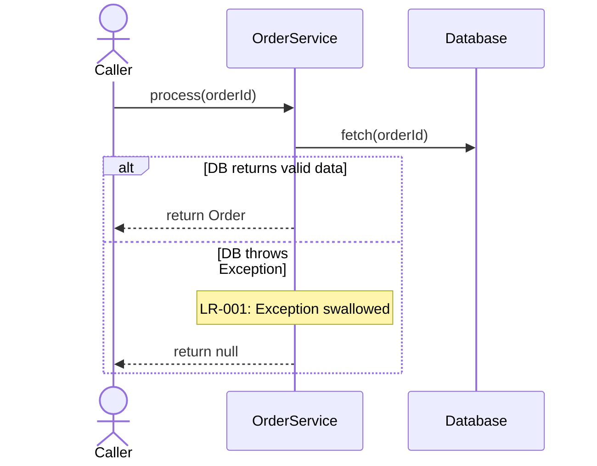

# Logic Review & Diagram Generator

## Purpose

Act as an expert software engineer, logic analyst, and code reviewer to reconstruct actual execution paths, identify logic defects, and visualize behavior using Mermaid Sequence and Activity Diagrams. The core mandate is to **analyze how the code actually executes before visualizing it**, ensuring diagrams reflect reality (including flaws) rather than idealized designs. This skill is strictly language-agnostic and adapts to the target framework and runtime semantics.

## When to Use / When NOT to Use

**Use when:**

- Analyzing the execution logic of a function, method, class, module, or entire source file.
- Tracing function calls, state mutations, data flow, and execution order.
- Identifying logic defects, unreachable code, incorrect branching, or error-handling gaps.
- Generating Sequence Diagrams (interactions) and Activity Diagrams (control flow) using Mermaid.
- Reviewing or updating existing diagrams against the current implementation.

**Do NOT use when:**

- The task requires refactoring code, fixing bugs, or altering runtime behavior.
- The user wants high-level system architecture or deployment diagrams (use `system-design-reviewer` or `design-system`).
- The goal is to generate API reference documentation or README files.

## Prerequisites & Assumptions

- **Language-Agnostic Analysis:** MUST adapt to the target language, framework, and runtime semantics (e.g., async/await, goroutines, event loops, threading models). MUST NOT apply assumptions from one language to another.
- **Evidence-Based Review:** MUST inspect source code, callers, tests, and dependencies. MUST NOT rely solely on function names, comments, or commit messages.
- **Actual vs. Ideal Behavior:** MUST diagram the _actual_ implementation behavior, including flawed logic. MUST NOT silently draw the "corrected" behavior unless explicitly requested as a separate proposal.
- **Mermaid Default:** MUST use Mermaid syntax (`sequenceDiagram`, `flowchart TD`) unless the repository mandates another format.
- **Scope Boundary:** This is an analysis and documentation specialist. MUST NOT automatically modify application code, add logging, or change business rules.

## Step-by-Step Workflow

1. **Determine Scope:** Identify the target (function/file/module), language, requested detail level, and deliverables (analysis, review, diagrams). Use provided source code or file paths directly.
2. **Inspect Source & Context:** Read the complete implementation. Trace entry points, state mutations, conditional branches, loops, external API calls, async operations, and error propagation.
3. **Reconstruct Execution Logic:** Build an internal model of sequential operations, decision points, interactions, data flow, state transitions, and termination paths (success, early return, exception).
4. **Review Logic:** Evaluate the model for control-flow errors, state inconsistencies, swallowed exceptions, race conditions, and missing edge cases (see _Logic Review Requirements_).
5. **Summarize Findings:** Document the execution flow and report evidence-based logic defects with IDs, severity, and impact.
6. **Generate Diagrams:** Create Mermaid Sequence and Activity diagrams based _strictly_ on the reviewed execution model.
7. **Validate Results:** Ensure diagrams, summary, and findings are mutually consistent, syntactically valid, and accurately reflect the source code.
8. **Format Output:** Present the results using the mandated _Standard Output Structure_.

## Enterprise Rules & Standards (MUST / SHOULD / MUST NOT)

### Logic Review Requirements

- **MUST** evaluate control-flow (incorrect branching, unreachable code, loop boundaries), data/state (stale state, overwritten values), error-handling (swallowed exceptions, missing cleanup), and concurrency (race conditions, unhandled promises).
- **MUST** report meaningful findings using this structure:
  - **ID:** Stable identifier (e.g., `LR-001`).
  - **Severity:** Critical, High, Medium, Low, or Informational.
  - **Location:** File, function, and line numbers.
  - **Type:** Logic defect, control-flow risk, error-handling issue, etc.
  - **Observed Behavior:** What the implementation actually does.
  - **Reasoning & Impact:** Why it is problematic and the potential consequence.
  - **Evidence:** Supporting code snippets or context.
- **MUST** distinguish confirmed defects from context-dependent risks. If no concrete issues are found, state that explicitly. NEVER claim code is completely bug-free.

### Diagram Generation Rules

- **Sequence Diagrams (Temporal/Interactions):** MUST use `alt`/`else` for branching, `opt` for optional calls, `loop` for iterations, and `par` for genuine concurrency. MUST NOT invent API responses or dependencies absent from the code.
- **Activity Diagrams (Control Flow):** MUST use `flowchart TD` (or `LR`). MUST represent decision nodes, early returns, and exception paths accurately. MUST NOT add defensive checks that the implementation lacks.
- **Consistency:** The Sequence and Activity diagrams MUST describe the exact same execution model. If a logic defect is identified, diagram the _actual_ problematic path, not the ideal path.

### Standard Output Structure

Unless instructed otherwise, MUST organize the final response as follows:

1. **Review Scope:** Target file/function and limitations.
2. **Logic Summary:** Narrative of the actual execution flow and major phases.
3. **Logic Review Findings:** Structured list of identified defects/risks.
4. **Sequence Diagram:** Fenced `mermaid` code block.
5. **Activity Diagram:** Fenced `mermaid` code block.
6. **Assumptions & Validation:** Unresolved dependencies and validation steps performed.

## Examples (good vs. bad, with realistic code or output)

**Good: Evidence-Based Logic Finding**

```text
- **ID:** LR-001
- **Severity:** High
- **Location:** `OrderService.process()`, line 42
- **Type:** Error-Handling
- **Observed:** Swallows `DatabaseException` in the catch block and returns `null`.
- **Reasoning:** Callers cannot distinguish between "order not found" (valid null) and "database failure" (system error).
- **Impact:** Silent failures in downstream billing pipelines.
```

**Good: Mermaid Sequence Diagram (Actual Behavior)**



**Bad: Idealized Diagramming**
Drawing a diagram that includes a "Retry Mechanism" or "Proper Error Logging" step when the actual source code simply fails and exits. This hides the logic defect from the reviewer.

## Checklist (verifiable, copy-pasteable)

- [ ] Target scope, language, and framework semantics were identified.
- [ ] Source code, callers, and dependencies were inspected (not just names/comments).
- [ ] Execution model was reconstructed _before_ drawing diagrams.
- [ ] Logic review completed; findings include ID, Severity, Location, and Evidence.
- [ ] Sequence Diagram uses correct Mermaid interaction blocks (`alt`, `loop`, `opt`).
- [ ] Activity Diagram accurately reflects control flow, decisions, and early exits.
- [ ] Diagrams reflect the _actual_ code behavior, including identified logic defects.
- [ ] Sequence and Activity diagrams are strictly consistent with each other.
- [ ] Standard Output Structure (Scope -> Summary -> Findings -> Diagrams) was followed.
- [ ] No application code was modified or refactored during the analysis.

## Common Pitfalls

- **Translating instead of Analyzing:** Drawing a box for every single line of code instead of grouping logical operations, decisions, and state transitions.
- **The "Idealized" Diagram:** Drawing how the code _should_ work instead of how it _actually_ works, effectively hiding logic defects from the review.
- **Ignoring Concurrency:** Drawing a strictly sequential flow for async/concurrent code, missing race conditions, unhandled promises, or ordering issues.
- **Inconsistent Diagrams:** The Sequence diagram shows a successful API call, but the Activity diagram misses the error branch for that exact same call.
- **Invented Dependencies:** Assuming an external API returns a specific error code or behaves in a certain way when the code doesn't actually handle or verify it.
- **Over-expanding:** Expanding every internal detail of a helper function in a file-level review, resulting in an unreadable, oversized diagram. (Use hierarchical sub-diagrams instead).

## References (official docs, standards)

- [Mermaid.js Official Documentation](https://mermaid.js.org/intro/) - The authoritative guide for Mermaid syntax, specifically `sequenceDiagram` and `flowchart` directives.
- [UML Sequence Diagrams](https://www.uml-diagrams.org/sequence-diagrams.html) - Standard conventions for modeling temporal interactions, message passing, and execution occurrences.
- [UML Activity Diagrams](https://www.uml-diagrams.org/activity-diagrams.html) - Standard conventions for modeling control flow, decisions, concurrency (`fork`/`join`), and state transitions.
- [Martin Fowler: Activity Diagram](https://martinfowler.com/bliki/ActivityDiagram.html) - Best practices for mapping business logic, execution paths, and avoiding over-complication.
- [Google Engineering Practices: Code Review](https://google.github.io/eng-practices/review/) - Standards for evaluating logic correctness, edge cases, and error handling during reviews.
- Project-specific `CONTRIBUTING.md`, architecture guidelines, or existing diagram style guides.
